<p align="center">
  
</p>

<p align="center">
  <a href="https://github.com/esmith443/Better-Wooting-Cyberpunk77-Analog-Controls/releases/latest"></a>
  
  
  
</p>

<p align="center">
  <b>Your Wooting reads every millimeter of travel. Night City only heard <i>on</i> and <i>off</i>.</b><br>
  Feather <kbd>W</kbd> to creep past a Militech checkpoint, slam it to sprint.<br>
  Ride the throttle through Kabuki, trail-brake into corners, steer like you mean it.
</p>


<a href="https://youtu.be/ydOv9OQNgKg"></a>


- **Analog everything** · walk, run, sprint, steer, throttle, brake. Cars, bikes, tanks, remote-hacked rides.
- **Plug-and-jack** · detects your Wooting at launch. No Wooting, no changes.
- **Keyboard prompts stay keyboard** · no Xbox icons flickering on your HUD.
- **Your binds, your layout** · reads the game's keybindings, remaps included.
- **No gamepad emulation, no edited game files** · rebuilds its bindings from the game every launch, so patches don't break it.


**Chrome required:** [RED4ext](https://github.com/wopss/RED4ext/releases) · [redscript](https://github.com/jac3km4/redscript/releases) · [Input Loader](https://github.com/jackhumbert/cyberpunk2077-input-loader/releases) · Wootility<br>
**Optional:** [Mod Settings](https://github.com/jackhumbert/mod_settings/releases) for the settings page · [Codeware](https://github.com/psiberx/cp2077-codeware/releases) for the debug meters

1. Grab `WootingAnalog-x.y.z.zip` from [Releases](https://github.com/esmith443/Better-Wooting-Cyberpunk77-Analog-Controls/releases/latest).
2. **Vortex:** Mods → *Install From File* → pick the zip → Deploy.<br>
   **Manual:** copy the zip's `red4ext` and `r6` folders into your `Cyberpunk 2077` folder.
3. Wootility → Settings → Gamepad mode → **None**.
4. Load a save. The HUD says `Wooting ... detected`.
5. Restart once more: analog throttle and brake come online from the second launch.

> [!WARNING]
> Ran the old *Analog Keyboard Movement and Driving Binds* mod? Verify your game files first, it overwrote `inputUserMappings.xml`.

**Uninstall:** remove it in Vortex, or delete `red4ext/plugins/WootingAnalog` and `r6/scripts/WootingAnalog`.


**Settings → Mods → Wooting Analog**, live while you play. No Mod Settings? Edit `red4ext/plugins/WootingAnalog/WootingAnalog.ini`.

<p align="center">
  
  
</p>

| Knob | Does |
|---|---|
| **Deadzone** | key travel ignored at the top |
| **Full press at** | travel that already counts as maxed out |
| **Response curve** | `1` = linear, higher = finer control on light presses |


<p align="center">
  
</p>

Flip **Debug mode** on to see every key's travel next to what the game receives. Grey line = deadzone, white line = full press. Can't sprint? Push **Sent: stick Y** past the red `0.9` line, or lower *Full press at*. Something off? <kbd>Ctrl</kbd>+<kbd>Shift</kbd>+<kbd>F10</kbd> drops a snapshot into the log.


```
git clone --recursive https://github.com/esmith443/Better-Wooting-Cyberpunk77-Analog-Controls
build.bat
```

Visual Studio 2022+ with the C++ workload. Output lands in `dist/`.


- **HUD says `Wooting Analog off: ...`** · it names the missing piece: keyboard, SDK or Input Loader.
- **No HUD message at all** · another mod broke redscript. Check `r6/logs/redscript_rCURRENT.log`.
- **Everything else** · `red4ext/logs/WootingAnalog-*.log` and `red4ext/plugins/WootingAnalog/WootingAnalog.status.txt`.


